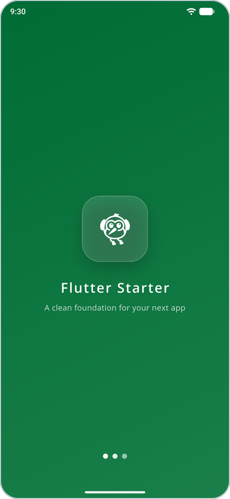
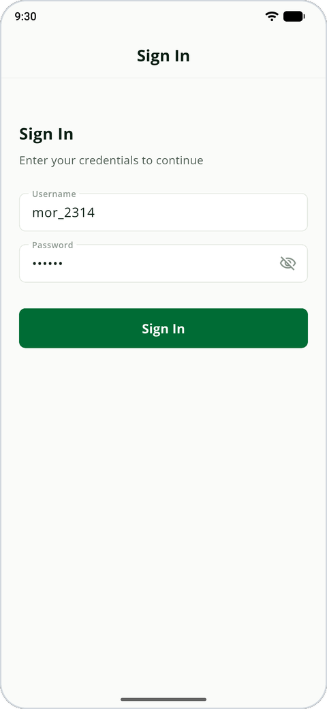
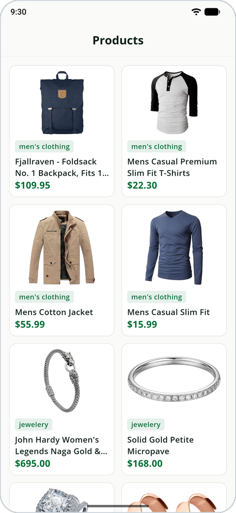
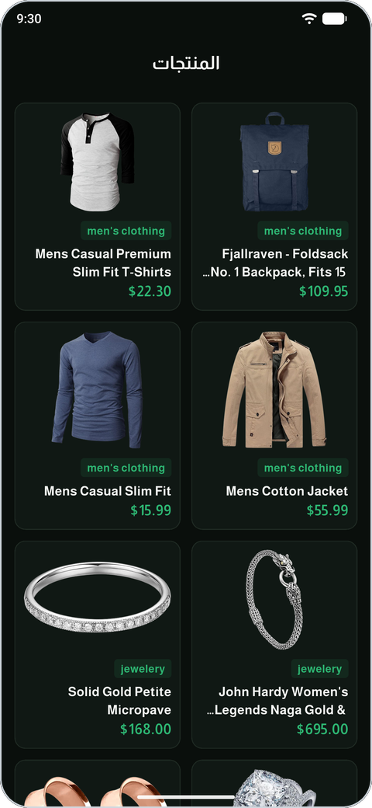
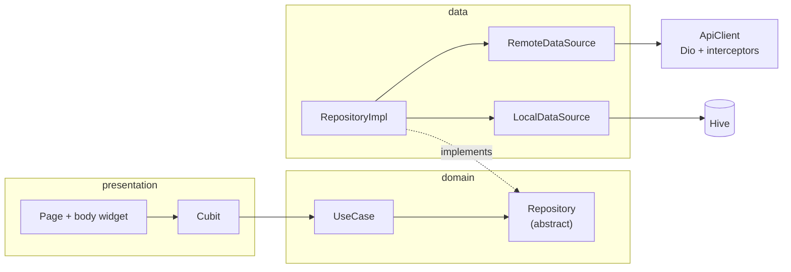

# Flutter Starter

A starter template for Flutter apps on Android and iOS, built on **Clean Architecture** with
one folder per feature. It includes what most apps need on day one: an API client with
interceptors, route guards, local storage with Hive, light and dark themes, and Arabic and
English with right-to-left layout. Two sample features, sign-in and a product list, call
[Fake Store API](https://fakestoreapi.com), so the whole stack runs as soon as you clone it.


<p align="center">
  
  
  
  
</p>
<p align="center"><sub>Splash, sign-in and the product grid, then the same grid in Arabic with the dark theme.</sub></p>

---

## Highlights

- **Clean Architecture, one folder per feature.** Every feature has `domain`, `data`,
  `presentation` and `di` folders. Repositories return a custom `Either<Failure, T>`, so pages
  never handle exceptions, and each feature registers its own dependencies with GetIt.
- **An API client for the common cases.** `ApiClient` wraps Dio with four interceptors. They
  add the auth token and the `Accept-Language` header, stop a request early when the device is
  offline, clear the session and return to sign-in on a `401`, and print colored request and
  response logs in debug builds. Network errors become translated messages.
- **Routes with guards.** Each route is a value of the `AppRoute` enum. `AuthGuard` and
  `GuestGuard` redirect before a page opens, `NavigationService` navigates without a
  `BuildContext`, and `PageRouteAnimator` provides fade, slide and scale transitions.
- **Arabic and English, right to left included.** You write each string once, in both
  languages, in `translations.json`. A generator checks the file, then writes the language
  files and typed `LocaleKeys`. The app follows the device language until the user picks one,
  and it remembers that choice.
- **Light, dark and system themes.** Widgets read colors and text styles from `context.colors`
  and `context.styles` instead of hard-coding them, and `.sp(context)` scales font sizes with
  the screen width. Four font families are bundled, including Almarai and Readex Pro for
  Arabic.
- **Cached data.** The product list saves each response in Hive and shows the saved list when
  a request fails.
- **Ready-made widgets.** Buttons, text fields, an app bar, cached network images, OTP input,
  loaders, empty and error states, dialogs and snackbars. `Validator` adds more than 20 form
  validators with translated messages.
- **Code generators.** Scripts create typed constants for assets, fonts and translation keys,
  and a lint script lists the constants that no code uses.
- **Built for Claude Code.** [`CLAUDE.md`](CLAUDE.md) and 16 skills in
  [`.claude/skills/`](.claude/skills) record the project's rules, so features that Claude Code
  adds follow the same patterns as the existing ones.

## Architecture

`presentation` and `data` both depend on `domain`, and `domain` never imports either of them.
Code that every feature shares lives in `lib/core/`.



A request goes from the page to its Cubit, then to a use case and the repository. The
repository implementation catches Dio and storage errors and returns `Left(failure)` or
`Right(data)`. The Cubit turns that result into a Freezed state, and the page draws it.

### Project structure

```text
lib/
├── main.dart                 # starts Hive and dependency injection, then runs the app
├── app/                      # MaterialApp and AppCubit (theme and language)
├── core/
│   ├── constants/            # AppSettings, EnvironmentConfig, ApiEndpoints, colors, padding
│   ├── di/                   # GetIt service locator (sl)
│   ├── errors/               # Failure, ServerFailure
│   ├── extensions/           # context.colors, context.styles, .sp(), .tr(), safeEmit
│   ├── localization/         # TranslationManager and delegates
│   ├── network/              # ApiClient, interceptors, NetworkMonitor
│   ├── routing/              # AppRoute, RouteManager, guards, transitions
│   ├── services/             # FcmService and GoogleAuthService (off by default)
│   ├── shared/               # Either, Usecase
│   ├── storage/              # Hive storage service and boxes
│   ├── themes/               # light and dark themes, AppThemeManager
│   ├── ui/                   # components, dialogs, snackbars, text styles
│   └── utils/                # Validator, Debouncer, PaginationController, pickers, logger
├── features/
│   ├── authentication/       # sample: sign-in
│   ├── products/             # sample: product grid, the reference feature
│   └── splash/
└── generated/                # assets.dart, fonts.dart, locale_keys.dart (generated)

assets/translations/translations.json   # the only file you edit for text
helpers/                                # code generators: dart helpers/<name>.dart
.claude/skills/                         # Claude Code skills
```

## Getting started

**You need:** Flutter 3.38 or newer (Dart 3.10+), and an Android emulator, an iOS simulator
or a device.

```bash
git clone https://github.com/aymansalkhatib/flutter-starter.git
cd flutter-starter
flutter pub get
flutter run
```

The generated files (`*.freezed.dart`, `*.g.dart` and `lib/generated/`) are committed, so the
app runs without a build step. The sign-in form comes filled in with a Fake Store API test
account (`mor_2314`), so you only need to tap **Sign In**.

### Make it yours

| What | Where |
| --- | --- |
| App name | `appName` in `AppSettings`, `android:label` in `AndroidManifest.xml`, `CFBundleDisplayName` in `ios/Runner/Info.plist` |
| Application ID | `applicationId` and `namespace` in `android/app/build.gradle.kts` (and the Kotlin folder), `PRODUCT_BUNDLE_IDENTIFIER` in Xcode |
| Package name | `name` in `pubspec.yaml`, then replace `package:flutter_starter/` in imports |
| API | base URLs for development and production in `environment_config.dart`, paths in `api_endpoints.dart` |
| Colors and fonts | `lib/core/constants/app_colors.dart` and `lib/core/themes/` |
| Icon and splash | add the logo files that `pubspec.yaml` names under `assets/images/`, then run `dart run flutter_launcher_icons` and `dart run flutter_native_splash:create` |
| Push notifications (optional) | set up Firebase (for example with `flutterfire configure`), then uncomment `FcmService().initialize()` in `lib/main.dart` |
| Google Sign-In (optional) | call `GoogleAuthService().initialize(clientId: …, serverClientId: …)` |
| Device Preview (optional) | set `isDevicePreviewActive` to `true` in `AppSettings` |

## Everyday tasks

### Add text in both languages

1. Add an entry to `assets/translations/translations.json`:

   ```json
   "cartEmpty": {
     "en": "Your cart is empty",
     "ar": "سلتك فارغة"
   }
   ```

2. Run `dart helpers/translation_codegen.dart`. It stops with an error if an entry is missing
   a language or has an empty value, and it warns when two keys would produce the same name.
   If there are no errors, it writes `assets/locales/<language>.json` and
   `lib/generated/locale_keys.dart`.
3. Use the key in a widget: `Text(LocaleKeys.cartEmpty.tr(context))`.

### Add an asset

1. Put the file in a folder under `assets/`, such as `assets/images/logo.png`, and list the
   folder in `pubspec.yaml`.
2. Run `dart helpers/asset_codegen.dart`, then use `AppAssets.images.logo` in code.
3. Run `dart helpers/asset_usage_lint.dart` from time to time. It lists generated asset, font
   and translation constants that nothing in `lib/` uses.

### Add a feature

- **With Claude Code:** ask for the `generate-feature` skill, for example *"Use
  generate-feature to add an orders feature that lists GET /orders"*. It asks whether you
  want quick or detailed mode, asks about the feature's name, scope, endpoints, caching and
  navigation, and states its assumptions. Then it writes the domain, data, presentation and
  DI files in order.
- **By hand:** copy `lib/features/products/` and rename it, register its
  `di/<feature>_dependencies.dart` in `initializeDependencies()`, and add the route. A route
  needs three edits: the `AppRoute` enum, the `generateRoute` switch and the `_guardsFor`
  switch in `route_manager.dart`.

After you add or change Freezed or JSON classes, run:

```bash
dart run build_runner build --delete-conflicting-outputs
```

[COMMANDS.md](COMMANDS.md) lists the other commands for builds, code generation and Android.

## Working with Claude Code

`CLAUDE.md` is the entry point. It names the key classes and paths, lists the hard rules (no
hard-coded strings, colors or padding in widgets; Cubits never touch `BuildContext`; a new
route needs all three edits), and points to a skill for each area. Claude Code loads a skill
only when a task needs it.

<details>
<summary>The 16 skills</summary>

| Skill | Covers |
| --- | --- |
| `architecture` | Where a file goes, layer dependencies, feature folders |
| `domain-layer` | Freezed entities, use cases with params, repository contracts |
| `data-layer` | Data sources, `RepositoryImpl` as the `Either` boundary, error mapping |
| `presentation-layer` | Cubit, Freezed state, page and body split |
| `di-registration` | Each feature's GetIt registrations |
| `navigation` | Routes, guards, transitions, typed route arguments |
| `hive-caching` | Boxes, keys, `@HiveType` entities, invalidation |
| `security` | Tokens, PII, encrypted storage, logging, deep links |
| `translations` | Adding text and running the codegen |
| `theming` | Colors, typography, spacing, dark mode and RTL |
| `ui-components` | The catalog of shared widgets |
| `validation` | Form validators |
| `ux-principles` | Hierarchy, spacing grid, motion, screen states, accessibility |
| `code-style` | Anti-patterns to check before finishing a file |
| `generate-feature` | Creating a whole feature, layer by layer |
| `migrate-packages` | Printing `flutter pub add` commands from `pubspec.yaml` |

</details>

## Tech stack

**Flutter 3.38+** · flutter_bloc (Cubit) · get_it · Dio · Hive CE · Freezed and
json_serializable · connectivity_plus · cached_network_image · skeletonizer · flutter_svg ·
firebase_messaging · google_sign_in · device_preview · flutter_native_splash ·
flutter_launcher_icons

## Author

**Ayman Al-Khatib** · [@aymansalkhatib](https://github.com/aymansalkhatib)

Issues and pull requests are welcome.
